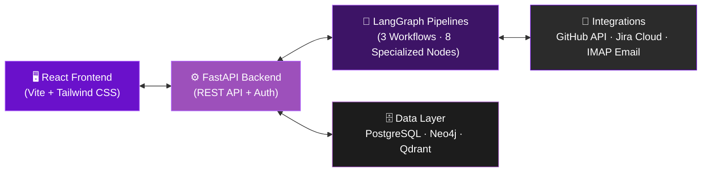

<div align="center">

  

  

  <br>

</div>
<p align="center">
  
  
  
  
  
</p>

<p align="center"> 
  
  
  
  
  
  
  
  
  
</p>

<div align="center">
### 🔮 Automated Requirement Intelligence & PR Compliance Platform

[🌐 Live Web App](https://scopesentinel-frontend.onrender.com) • [📖 Live API Docs](https://scopesentinel-backend.onrender.com/docs) • [Overview](#-overview) • [Key Features](#-key-features) • [Architecture](#-architecture) • [Agent Pipelines](#-agent-pipelines) • [Quick Start](#-quick-start) • [Tech Stack](#-tech-stack)

</div>
<br>

---

## 🌐 Live Cloud Deployment

| Service | Status | Link |
|---|---|---|
| **Frontend Web App** | 🟢 Live | [scopesentinel-frontend.onrender.com](https://scopesentinel-frontend.onrender.com) |
| **Backend API Docs (Swagger)** | 🟢 Live | [scopesentinel-backend.onrender.com/docs](https://scopesentinel-backend.onrender.com/docs) |
| **Demo Login** | 🔑 Active | `pm@scopesentinel.com` / `password123` |

<br/>

## 📌 Overview

**ScopeSentinel** bridges the gap between what was *specified* in product conversations (meetings, emails, Jira tickets) and what is *shipped* in your GitHub repository.

In real-world software development:
1. Requirements evolve in conversations without documentation updates.
2. Teams lack visibility into whether stated requirements are actually covered by codebase implementations.
3. Pull requests get merged without verifying compliance against sprint specifications.

ScopeSentinel automates requirement extraction, flags drift with word-level diffs, traces ripple effects through a dependency graph, scores implementation coverage, and audits PRs automatically.

<br/>

## ✨ Key Features

- **Requirement Extraction**: Ingest raw meeting notes, emails, and Jira tickets; turns unstructured text into structured requirement statements.
- **Drift Detection & Word-Level Diff**: Compares incoming requirements against baselines via semantic similarity and dynamic programming Myers LCS word-level diffing.
- **Graph Impact Analysis (Neo4j)**: Uses Breadth-First Search (BFS) to traverse module dependencies and identify downstream components impacted by a change.
- **Risk Scoring Engine**: Quantifies the blast radius of changes (0–100) combining change type, similarity, and graph depth.
- **Codebase Coverage Scorer**: Scans connected GitHub repositories and computes per-requirement implementation coverage percentages.
- **PR Compliance Reviewer**: Evaluates pull requests against active requirements, flags missing implementations, and prepares review comments.
- **Mission Control Dashboard**: 13-page dark-themed React UI with JWT role-based access (PM, Developer, QA), real-time alerts, and sprint reporting.
- **Claude Desktop MCP Server**: Lightweight Model Context Protocol server exposing project requirements and risk queries to AI desktop clients.

<br/>

## 🏗️ Architecture



<br/>

## 🔄 Agent Pipelines

The system organizes its 8 specialized agent nodes across 3 decoupled **LangGraph** workflows:

### 1. Requirement Drift & Impact Pipeline
Triggered when new text or documents are submitted:
```
[Extractor] ──> [Change Detector] ──> [Impact Analyzer (Neo4j BFS)] ──> [Risk Scorer] ──> [Notifier]
```
- **Extractor**: Identifies requirement statements, types (functional, non-functional, constraint), and confidence scores.
- **Change Detector**: Flags modifications vs. new additions using semantic similarity and word diffs.
- **Impact Analyzer**: Runs BFS across the Neo4j graph to find affected modules up to depth 3.
- **Risk Scorer**: Evaluates blast radius (0–100) using graph impact and change magnitude.
- **Notifier**: Determines alert severity and routes updates to the dashboard, email, or Slack.

### 2. GitHub Coverage Pipeline
Triggered during repository scans:
```
[GitHub Repo Scanner] ──> [Coverage Scorer]
```
- **GitHub Scanner**: Connects via PyGithub and categorizes files (frontend, backend, database, test, config).
- **Coverage Scorer**: Maps requirements against repository structure to estimate coverage percentage.

### 3. PR Compliance Pipeline
Triggered manually or via GitHub webhook:
```
[PR Reviewer Node]
```
- **PR Reviewer**: Audits PR file diffs against active sprint requirements, highlights missing tests/components, and generates audit feedback.

<br/>

## 🧰 Tech Stack

| Layer | Technology |
|---|---|
| **Frontend** | React 18, Vite, Tailwind CSS, Recharts, React Router, Axios, Lucide Icons |
| **Backend** | FastAPI, SQLAlchemy, Pydantic, python-jose (JWT), bcrypt |
| **Workflows & AI** | LangGraph, LangChain Core, OpenAI (GPT-4o-mini) / Ollama with NLP heuristic fallback |
| **Databases** | PostgreSQL (relational core), Neo4j (module dependency graph), Qdrant (vector similarity) |
| **Integrations** | PyGithub (repository scanning & PR review), Jira Cloud REST API v3, IMAP Email, MCP |
| **DevOps** | Docker Compose, Render (1-click Blueprint), Railway |

<br/>

## 🚀 Local Quick Start

### Prerequisites
- [Docker Desktop](https://www.docker.com/products/docker-desktop/)
- [Python 3.11+](https://www.python.org/downloads/)
- [Node.js 18+](https://nodejs.org/)

<details>
<summary><b>1. Clone & Configure Environment</b></summary>

```bash
git clone https://github.com/KalagiPandya/ScopeSentinel.git
cd ScopeSentinel

cp backend/.env.example backend/.env
```

*(Optional)* Add your `OPENAI_API_KEY` in `backend/.env`. If omitted, the built-in heuristic fallback engine runs automatically for offline demos.

</details>

<details>
<summary><b>2. Start Data Services (Docker)</b></summary>

```bash
docker compose up -d
```

Starts PostgreSQL, Neo4j, and Qdrant containers.

</details>

<details>
<summary><b>3. Start Backend</b></summary>

```bash
cd backend
python -m venv venv
venv\Scripts\activate        # macOS/Linux: source venv/bin/activate
pip install -r requirements.txt

# Starts server and automatically seeds demo project and users
uvicorn app.main:app --reload --host 0.0.0.0 --port 8000
```

Visit **http://localhost:8000/docs** to explore the interactive Swagger API documentation.

</details>

<details>
<summary><b>4. Start Frontend</b></summary>

```bash
cd frontend
npm install
npm run dev
```

Visit **http://localhost:5173** and log in with any seeded demo account:

```
Product Manager : pm@scopesentinel.com  / password123
Developer       : dev@scopesentinel.com / password123
QA Engineer     : qa@scopesentinel.com  / password123
```

</details>

<br/>

## 📺 Screens Tour

| Page | Description |
|---|---|
| **Dashboard** | High-level metrics, risk score gauge, requirement coverage breakdown |
| **Upload Center** | Ingest meeting notes, documents, or Jira text to run the change pipeline |
| **Change Center** | Interactive word-level diff viewer highlighting added and removed terms |
| **Impact Graph** | Visualizes affected modules by depth from Neo4j dependency traversal |
| **Risk Center** | Risk distribution analytics and filterable change register |
| **GitHub Center** | Repository file classification and recent commit history |
| **Coverage Center** | Requirement-to-code coverage percentage with found/missing details |
| **PR Review Center** | Automated PR audit preview and GitHub review comment generation |
| **Notifications** | Alert history across dashboard, email, and Slack channels |
| **Team Management** | Role-based permission controls (PM, Developer, QA) |
| **Reports** | Exportable sprint compliance and requirement status reports |
| **Settings** | Configuration for linked repository and third-party credentials |

<br/>

## 📄 License

Distributed under the **MIT License**. See [`LICENSE`](./LICENSE) for details.

<br/>

<div align="center">


</div>
